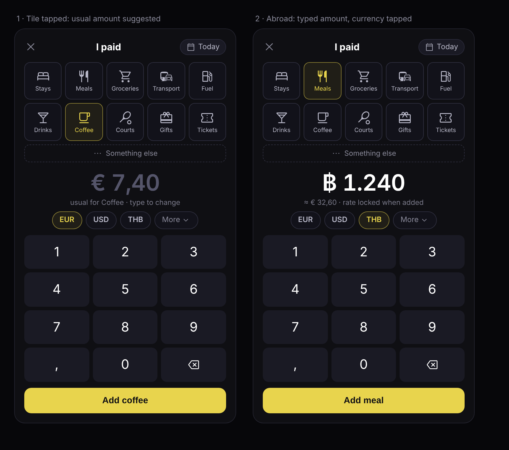

# Schplitz

Shared expenses, without an account. [Open Schplitz](https://schplitz.com).

## Why I built it

I was tired of expense-splitting apps that seemed to come with some for-profit, data-mining backstory. I just want to keep track of shared expenses with friends.

Excel got me part of the way, but different currencies and different groups needed something smarter. Schplitz is my attempt at that: a shared tally that tells you whose turn it is, with encrypted updates you send through the chat you already use.

## How it works

Start a tally, add your friends, and choose a question with an answer your group knows. Record what you paid and who was there. Schplitz keeps the amounts in a common currency and tells you who's ahead, or whose round is next.

Updates travel in encrypted links. Your friends open a link to bring their tally up to date; there is no application backend holding the shared ledger. Schplitz 2 supports pairs and groups of up to ten.



## Run locally

Use Node.js 24 (the version in `.nvmrc`, also used by CI). If you use nvm, run `nvm install` and `nvm use` first. Install dependencies with npm, then start Vite:

```sh
npm ci
npm run dev
```

Open [localhost:5173/v2/](http://localhost:5173/v2/) for Schplitz 2. By default, the root serves Schplitz 1; `/classic/` also serves the old app. The build-time `VITE_V2_AT_ROOT=true` switch moves Schplitz 2 to the root. See the [launch guide](docs/launch.md) for the full routing and rollback behavior.

```sh
npm run check
```

`npm run check` runs lint, unit tests, and both builds: the default configuration in `dist/` and Schplitz 2 at the root in `dist-launch/`. It explicitly sets the launch flag for each build, regardless of your local environment. The individual `test`, `lint`, and `build` commands remain available.

Lint currently covers `src/v2/`. Browser walkthroughs live in `e2e/`; they currently require Playwright and Chromium installed separately, plus a running preview server. See the [test instructions](src/v2/README.md#tests) and [launch checks](docs/launch.md#before-launch).

## Inside the project

React handles the screens and Vite builds the site. The tally and link logic are ordinary JavaScript modules, separate from React.

| Location | Responsibility |
| --- | --- |
| `src/v2/ui/` | Screens, input, formatting, and the landing page |
| `src/v2/app.js` | Application workflows and saving changes |
| `src/v2/tally.js` | Payments, balances, disputes, and merging updates |
| `src/v2/link.js` | Key derivation, encryption, and the link-size budget |
| `src/v2/cache.js` | IndexedDB storage on the device |
| `src/v2/schema.js` | Protocol fields, limits, and input validation |
| `src/v2/migrate.js` | Importing Schplitz 1 data and links |
| `src/App.jsx`, `src/utils.js` | The original application and its supporting code |

A few choices shape the implementation:

- Money is stored as integer minor units. Exchange rates are locked when a payment is recorded.
- Each device writes its own append-only log. Corrections are new entries too.
- Links carry running summaries, so an older link cannot roll a writer's balance back.
- Normal links carry a limited history window to stay small. A restored balance is not the same as a complete payment history; full-copy files preserve the older details.
- Encryption protects the link contents, but this is a tool for people who trust each other. Anyone who knows the shared answer can produce links; it is not a signed ledger that prevents group members from forging updates.

The [module guide](src/v2/README.md), [design notes](docs/v2.0.md), and [migration notes](docs/v2.0-migration.md) cover the details and tradeoffs.

## License

See [LICENSE](LICENSE). Bundled Material Symbols have their [own license](src/v2/ui/material-symbols-LICENSE.txt).
