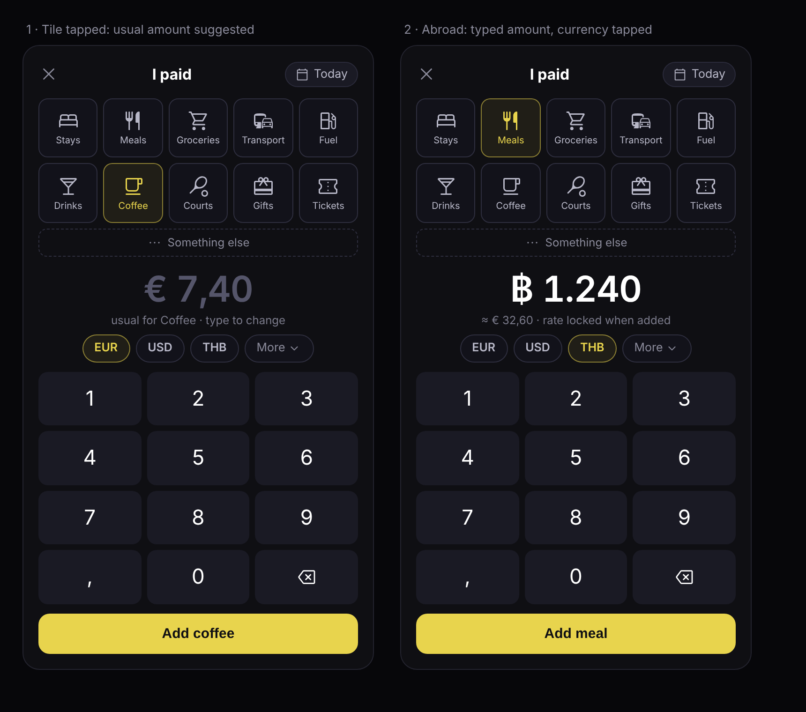

# Schplitz v2.0 — design description

Status: draft · October 2026

---

## 1. Philosophy

Schplitz v2 changes the job of the app from **settling up** to **keeping it fair**.

1. **Show who's ahead, not what's owed.** The app answers one question: *whose turn is it to cover next time?* There is no "settle up" moment, and a tally doesn't end. It swings back and forth the way a friendship does.
2. **Talk like people do, not like a bank.** On screen, balances are shown in social units ("about two rounds of beer", "a padel court") instead of euros and cents.

Money is still recorded exactly. People enter the amount they actually paid, in the currency they paid it in. The exact numbers are always available in a details view. They're just not front and center.

The v1 principles stay as they are: no server, no database, no account, no telemetry. Data is encrypted in the browser and moves between people only when they choose to send it.

---

## 2. Why v1 can't carry this

### 2.1 Share links grow without limit

Every v1 link carries the **entire history** of both people (`App.jsx` → `handleExport`). The only thing that keeps it bounded today is starting a new tally, and v2 removes that moment.

Measured with the app's own encryption and compression code:

| Expenses in tally | v1 link length |
|---|---|
| 10  | 750 chars |
| 50  | 1,900 |
| 100 | 3,250 |
| 200 | 6,150 |
| ~270 | 8,000 — the app's cap; falls back to copy-pasting text |

At about three shared payments a week, a pair hits the cap in under two years. Links over 2–3k characters already look broken in chat apps well before that.

About half of every link is the random 25-character expense IDs. With per-person sequence numbers instead, 200 entries drop from 5,470 to 2,850 characters. That's a constant-factor gain only; it doesn't remove the cap.

### 2.2 Other problems that get worse when a tally never ends

- **Importing deletes your unshared work.** Opening your friend's link *replaces* your expense list with theirs (`handleSetupImport` → `setExpenses(expenses)`), so anything you added since your last share is lost. With "I'm done, your turn" trips this rarely bites; with continuous use it happens regularly.
- **Anyone can delete anyone's entry,** and whether the delete sticks depends on who shares with whom last.
- **The two phones can show different balances.** Exchange rates are fetched live per device, with silent hardcoded fallbacks when offline, so balances can drift. Over a never-ending tally that difference accumulates.
- **Only one tally per device.** Storage is a single `localStorage` key, and a link from a different tally overwrites the current one.
- **Safari can wipe the data.** With Intelligent Tracking Prevention, Safari deletes script-writable storage (localStorage, IndexedDB) for sites the user hasn't interacted with in 7 days of browser use. Home-screen web apps are exempt. A pair who meets every two weeks can lose their tally.
- **Some data in the link isn't encrypted.** The security question and both names are readable in every link (only the part after `#`, so it never reaches a server, but chat apps and anyone holding the link can see it).
- **The share action is hard to repeat often.** The security answer lives in `sessionStorage`, so it has to be retyped in every new browser session.

---

## 3. Core idea: the chat is the database

Every link carries **everything needed to show the tally**: everyone's running totals plus the recent history. The latest Schplitz link in a chat therefore *is* the tally. Browser storage on the phone is only a cache: convenient, but nothing depends on it.

### 3.1 The property that makes it possible

**Each person only ever adds their own payments** (`paidBy: myName`). Each person's history is a log that only they write to, so two devices never edit the same thing.

That allows a **running summary per person**, which only its owner updates. Combining summaries from different links is trivial: per person, the highest-numbered summary wins.

### 3.2 Concepts

| Concept | Meaning |
|---|---|
| **Tally** | A shared ledger between 2 or more people. Has a random 128-bit `tallyId`. |
| **Member** | A person in the tally ("Sofia"). Has a random `memberId`; the name is just a label, so two Sams don't collide. |
| **Writer** | One device acting for one member. Has a random `writerId` and its own append-only log. A person on two phones = one member, two writers. A restored phone gets a new writer. |
| **Entry** | One item in a writer's log, numbered `1, 2, 3…` per writer. Identified by `(writerId, seq)`. |
| **Summary** | Per writer, the running result of their whole log: latest `seq`, a hash chain head, the **net effect on each member** (integer cents), and **count + total per category**. Only the writer updates it. |
| **Correction window** | The recent part of history that travels in every link, so it can be checked, questioned and corrected (§3.5). |

### 3.3 Entry types

All entries are append-only. Corrections are new entries, so they travel like any other change, however old the entry they correct.

| Type | Written by | Fields | Notes |
|---|---|---|---|
| `pay` | payer | category, amount, currency, tally-currency value, date, participants | A payment. |
| `edit` | payer | target seq, changed fields | Fix your own entry: amount, date, category, participants. |
| `void` | payer | target seq | Delete your own entry. |
| `back` | either | amount, to member | Optional "paid back" transfer. Amount only, no message. |
| `notme` | a participant | target `(writer, seq)` | *"I wasn't there."* Takes the writer of this entry out of the split straight away (§3.5). |
| `query` | a participant | target `(writer, seq)`, reason code | *"Check this."* Reasons: amount, date, category, duplicate. No free text. |
| `resolve` | payer | target `notme`/`query`, outcome | *Accepted* (usually together with an `edit`/`void`) or *kept as is*. |
| `cfg` | any member | tally name, members, tally currency | Last writer wins, ordered by Lamport timestamp, ties broken by `writerId`. |

### 3.4 What a link carries

```
#s=<version>.<tallyId>.<question>.<ciphertext>
                         └ plaintext header ┘ └ AES-256-GCM, deflated ┘
```

Inside the ciphertext:

1. **Every writer's latest summary**, as far as the sender knows. This alone gives the exact balance, whose turn it is, and lifetime totals per person and per category.
2. **The correction window:**
   - every entry from the **last 30 days**, from all writers;
   - at least the **last 20 entries**, however old;
   - every **open** `notme` / `query` and its target entry, whatever its age, until it's resolved.
3. **Recent corrections** (`edit`, `void`, `resolve`) for entries in the window.

Measured sizes, with a 2,000-character budget per link:

| Tally | Link contents | Length |
|---|---|---|
| Pair | summaries only | 348 chars |
| Pair | summaries + 20 entries | 696 chars |
| Pair | summaries + 40 entries | 932 chars |
| Group of 6 | summaries + 20 entries | 1,246 chars |
| Group of 12 | summaries + 10 entries | 1,984 chars |

- **A pair's link stays under about 1,000 characters forever.** The summaries don't grow with history.
- **Over budget** (a busy group trip): the oldest *closed* entries in the window are left out first. Open disputes are never left out. Everything left out is still on every phone that already received it.
- **Groups are capped at 10 members** to keep summaries plus a useful window within budget.

### 3.5 Corrections and disputes

The window exists so people can notice mistakes and fix them.

**Noticing.** When a link arrives, new entries that **include you** are listed before the toast disappears. Amounts well above the tally's usual for that category are highlighted:

> **Jessy added Meals · €100,00** · split 4 ways, including you
> **[ Looks right ]  [ Not me ]  [ Ask about it ]**

The same review stays available in the activity feed for the whole window.

**Fixing your own entry.** Tap it → change the amount, date, category or who was there → an `edit`. Or delete it → a `void`. These work on entries of any age, because the correction itself is new.

**"Not me"** (someone added you to something you weren't part of):

- It takes effect **immediately** for the balance (decided): the entry is re-split among the remaining participants. In a pair, the entry no longer affects the balance at all.
- The payer sees *"Sofia says she wasn't at this dinner"* and can:
  - **Accept**: their `edit` updates the participants and closes the dispute;
  - **Put back**: closes it with *kept as is*, and Sofia is included again. Sofia can still raise it again. It's between friends, not a court.
- **How it's counted:** open `notme` entries are not folded into anyone's summary. They're applied on top of the summaries while open. Open disputes always travel in the window, so every link computes the same balance. Once resolved, the payer's `edit` (or the *kept as is*) is what counts.

**"Ask about it"** (wrong amount, wrong date, wrong category, duplicate):

- Changes nothing by itself. It flags the entry on the payer's phone with the reason. Only the payer can correct their own entry.
- It stays open, and in every link, until the payer edits, deletes, or answers *kept as is*.

**After the window.** Entries older than 30 days can still be edited by their payer, and can still be questioned from any phone that has them. They just no longer ride along in every link, so a newly wiped phone won't see them line by line.

### 3.6 Receiving a link

1. Look up `tallyId`. If it's known, decrypt with the stored key. No answer needed. If it's unknown, ask the answer (join or restore).
2. **Summaries:** per writer, keep the one with the highest `seq`. Opening links in any order, twice, or old ones, never rolls anything back.
3. **Entries in the window:** store the ones not yet stored, keyed by `(writerId, seq)`.
4. **Check:** for writers whose full log this phone has, recompute the summary from the entries and compare it with the hash chain head. A mismatch (bug, corruption, or tampering by someone with the key) is shown, with an offer to exchange full copies.
5. **Review:** show new entries that include you (§3.5).

### 3.7 What survives what

| Situation | Balance, whose turn, totals | Last 30 days line by line | Older line items |
|---|---|---|---|
| Normal use | ✓ | ✓ | ✓ (on the phone) |
| A link never arrives | ✓ next link has it all | ✓ next link has it all | ✓ |
| **Phone wiped** (Safari 7-day rule, cleared data, new phone) | ✓ **tap the latest link, type the answer** | ✓ same | from a friend's *Send full copy* or a backup file |
| Entries added but never shared, then phone wiped | **lost** | **lost** | — |

- **Unshared entries:** the share sheet opens right after *Add*, and the tally shows "1 not shared yet" until it's sent.
- **Full copy:** an encrypted `.schplitz` file with the complete history, sent through the share sheet. Any member can send one.
- **In person:** a link of 2,000 characters or less fits in a QR code. "Scan to sync" works across a table.

---

## 4. Multiple tallies on one device

- **Storage** moves from one `localStorage` key to IndexedDB, with one store per tally plus an index of tallies. On Safari this storage can still be deleted by the browser; see §4.1 for how that's handled.
- **Keys**: on joining, derive the tally key once with PBKDF2-SHA256 (answer, salt = `tallyId`). Store it as a **non-extractable** `CryptoKey` in IndexedDB. Each link uses a fresh random IV. Results:
  - the answer is typed **once per tally, ever**, not once per session;
  - links don't need a per-link salt;
  - script can use the key but can't read its raw bytes.
- **Routing**: the plaintext `tallyId` in the link tells the app which tally a link belongs to before decrypting. It's random, so it reveals nothing beyond "these links belong to the same tally".
- **Identity is per tally.** You can be "Thijs" in one tally and "T" in another. There is no global account.
- **Trade-off:** with stored keys, anyone holding your unlocked phone can open your tallies, the same as with a chat app. An optional app lock (passcode or WebAuthn) could come later.

---

### 4.1 Browser storage on iPhone and Mac (Safari)

**The rule.** Safari, on iOS and macOS, deletes everything a site has stored itself (localStorage and IndexedDB, so tallies and keys) after **7 days of Safari use without the person interacting with the site**. Only days on which Safari is used count. Visiting the site and tapping something resets the clock. (WebKit blog, *"Full Third-Party Cookie Blocking and More"*, March 2020.) **This already applies to v1 today.**

What it means for Schplitz:

- **An active tally is safe.** Every sync link someone taps resets the clock.
- **A quiet tally can be deleted from the phone,** for example friends who meet once a month. Since v2 keeps the tally in the chat (§3), that costs very little: **tap the latest link, type the answer**, and the balance, totals and last 30 days are back. Only line items older than the window need a friend's full copy or a backup file (§3.7).

**What doesn't solve it.** This replaces the earlier proposal to push *Add to Home Screen*:

- **Add to Home Screen** exempts the site from the 7-day rule. But on iOS, a home-screen web app has **its own storage, separate from Safari's**, and **links tapped in a chat app open in Safari, not in the home-screen app**. Pushing people to install would split their data across two places and break *"tap the link, your tally opens"*.
  - **iOS:** don't promote installing.
  - **Android and desktop:** offer it. Installed apps there share storage with the browser and can open links.
- **`navigator.storage.persist()`** protects against deletion when the phone is low on space. It isn't documented to exempt a site from the 7-day rule. Request it anyway; it's free.
- **In-app browsers.** Some chat and social apps open links inside themselves, with their own separate storage, so a tally opened there lives there. Detect the common in-app browsers and show *"Open in Safari to keep your tally"*.

**What solves it: not depending on it (§3), plus a few safety nets for older history.**

1. **The chat is the main backup.** Every link restores the balance and the correction window.
2. **Friends are the backup for older line items.** A friend's *Send full copy* restores the complete history (§3.7).
3. **Backup reminder on Safari only**, for people who want their complete history safe without a friend. After about 20 new entries or a month, a quiet prompt appears: *"Save a backup to Files"*. The file is encrypted and restores with the answer. Saved in iCloud Drive, it also survives a new phone.
4. **The wiped phone notices.** It looks like a brand-new phone, but when the next link arrives and the person picks their name, the app sees that this member already has entries: *"Welcome back, Liam. Your balance is restored from this link. For entries older than 30 days, ask Sofia for a full copy."* That's instead of starting over as if new.
5. **The friend's phone notices.** A link from Liam comes from a new writer starting at zero, while his old writer had entries. Sofia's app then offers *"Liam's phone seems to have lost the tally. Send him a full copy?"*
6. **Old v1 tallies:** every v1 link is a full copy, so *Bring in an old tally* can rebuild a tally from a chat even if Safari deleted the v1 data ([migration doc, step 6](v2.0-migration.md#step-6--keep-conversion-available-for-at-least-2-years)).

**Verify on real devices before building on it.** This can't be tested from the environment the doc was written in:

- iOS (current version): is a home-screen web app's storage still separate from Safari's, and do links from chat apps still open in Safari?
- Does a granted `persist()` change the 7-day behaviour?
- Which chat apps open links in an in-app browser on iOS (WhatsApp, Signal, Telegram, Instagram), and does that storage persist between visits?
- Chrome and Firefox on iOS also run on WebKit: do they apply the same 7-day rule?

---

## 5. Group tallies (3+ people)

The protocol in §3 is designed for N members from the start. A pair is just a group of two.

### 5.1 Who was there

In a pair, every payment is split 50/50. In a group, not everyone is at every coffee. Each `pay` entry carries **participants**: a bitmask of members, defaulting to everyone, tappable to exclude people. The payer can be excluded (for example, paying for others without having any).

### 5.2 Balances and whose turn

- Each payment is split equally among its participants.
- `net(member) = what they paid − their share of what they took part in`. The nets of all members add up to zero.
- **Whose turn** = the participant with the lowest net. When only some of the group meets up, the app picks among the people present: "Of you three tonight, it's Daan's round."
- In a pair this is the same as v1's balance, with the sign flipped into "ahead/behind".

### 5.3 Joining, leaving, lagging

- **Joining**: any link works as an invite, because every link carries the question. The new member picks their name from the list (the creator can pre-add names) or adds themselves. Claiming a name is a `cfg` entry. If two devices claim the same member, the app shows the conflict.
- **New members** get the balance and the last 30 days from any link. Older history comes as a full copy, if they want it.
- **Leaving / archiving**: a member's balance stays visible. A `back` entry can square it up if they want. Keys can't be revoked from someone who knows the answer. For friends that's acceptable. A "fresh start" can create a new tally that carries balances over.
- **People who never pay** are no problem: every link carries the complete balance, so nobody needs to confirm anything or catch up.

---

## 6. Categories instead of free text

**Decision: each payment gets exactly one category, picked by tapping a tile. Synced data contains no per-entry free text.**

Measured link sizes:

| | Free text | Category codes |
|---|---|---|
| Pair, 10 entries | 416 chars | 295 chars |
| Pair, 200 entries | 2,576 chars | 2,215 chars |

The size gain is real (15–30%) but it's not the main reason. The main reasons:

1. **Pillar 2 comes for free.** Categories *are* the social units. "Liam is about 2 rounds of drinks ahead" is computed from the tally's own history of Drinks entries.
2. **Privacy.** Free text is the most revealing data in a tally ("Dinner at Lima", "Pharmacy"). An exposed tally that contains only categories and amounts says much less.
3. **It closes a social-engineering channel.** v1's 500-character settlement message lets a malicious or compromised link display "Pay me at IBAN …". Without free text in synced data, a link can't show arbitrary text.
4. **Speed.** Logging after hanging out takes one tap, not typing on a phone.
5. **Language independence.** Category names translate. Free text doesn't.

### 6.1 The categories

| Code | Category | Tile label | Material Symbol | Social unit (one / several) |
|---|---|---|---|---|
| 1  | Stays         | Stays     | `bed`                 | a night's stay / nights' stay |
| 2  | Meals         | Meals     | `restaurant`          | a meal / meals |
| 3  | Groceries     | Groceries | `shopping_cart`       | a grocery run / grocery runs |
| 4  | Transport     | Transport | `commute`             | a ride / rides |
| 5  | Fuel          | Fuel      | `local_gas_station`   | a fill-up / fill-ups |
| 6  | Drinks        | Drinks    | `local_bar`           | a round of drinks / rounds of drinks |
| 7  | Coffee        | Coffee    | `local_cafe`          | a coffee / coffees |
| 8  | Sports courts | Courts    | `sports_tennis`       | a court booking / court bookings |
| 9  | Gifts         | Gifts     | `redeem`              | a gift / gifts |
| 10 | Tickets       | Tickets   | `confirmation_number` | a ticket / tickets |
| 0  | Something else | —        | `more_horiz`          | none (never used as a unit) |

- **Codes are permanent.** Never renumber or reuse a code. New categories get new codes. A client that doesn't know a code shows it as Something else.
- Drinks covers any drinks, not only beer, so its unit is "a round of drinks".

### 6.2 The logging screen

The whole payment fits on one screen with no typing: **tap a category, tap the amount, tap Add.**



The mockups are drawn at 375 × 667 (iPhone SE size), the smallest common phone. Everything fits without scrolling, and the numpad keys come out 110 × 58px.

From top to bottom:

1. **Top bar:** close, title "I paid", and chips for **date** (*Today*, tap for Yesterday or a date picker) and, in group tallies only, **who was there** (*Everyone*, tap to deselect people). This keeps the pair flow and the group flow the same height.
2. **Category tiles** (§6.2.1).
3. **Amount display:** a large amount with one line underneath.
4. **Currency chips** (§6.2.3).
5. **Numpad** (§6.2.2), filling the remaining height.
6. **Add button**, labelled with the category's singular name: *Add coffee*, *Add meal*.

#### 6.2.1 Tiles

- **Layout:** a 5 × 2 grid in a **fixed order** (the order above), so people learn where things are. Tiles are not reordered by usage. *Something else* is a full-width secondary button under the grid.
- **Selected state:** accent outline and tinted fill, matching the existing status buttons.
- **Labels:** tiles use the short label (Courts). The details view and the accessible name use the full name (Sports courts).
- **Narrow screens:** at 360px wide, "Groceries" and "Transport" fill their tile exactly. Below about 380px, reduce the grid gap and the card padding.
- **Accessibility:** each tile is a `button` with `aria-pressed` and the full category name as its accessible name. Icons are `aria-hidden`.

#### 6.2.2 Numpad

An always-visible numpad built into the screen, instead of the phone's keyboard:

- **Why not the system keyboard:** the system keyboard slides up and covers the tiles, it differs per phone, and it handles the decimal separator inconsistently (Dutch phones type a comma).
- **Calculator-style entry:** digits, then an optional decimal key. Typing `2 5` gives 25, not 0.25.
- **Limits:** at most 2 decimals and 7 whole digits. Leading zeros are dropped.
- **Currencies without decimals** (for example ALL, JPY, ISK, as reported by `Intl.NumberFormat`): the decimal key is disabled. Switching to such a currency drops any decimals already typed.
- **Decimal key** shows the locale's separator: a comma for `nl`/`de`, a dot for `en`. Hardware keyboards accept both.
- **Backspace** removes one character; a long press clears the amount.
- **Suggested amount:** after a tile is tapped, the tally's usual (median) amount for that category appears greyed out with *"usual for Coffee · type to change"*.
  - The first digit typed replaces it.
  - Backspace clears it.
  - *Add* accepts it as it is.
  - With no history for that category, nothing is suggested.
- **Display** formats the amount with `Intl.NumberFormat` in the user's locale, with grouping separators (*฿ 1.240*, *€ 7,40*).
- **Internally** the amount is a digit string, converted once to integer minor units on *Add*. No `<input type="number">` and no floating point.
- **Add** is disabled until a category is selected and the amount (typed or suggested) is above zero.
- **Keyboard and screen reader:** hardware keys work (digits, `,` and `.`, Backspace, Enter = Add, Escape = close). The amount display is an `aria-live="polite"` region. Every key is a `button` with an accessible name, and backspace is named "Delete".

#### 6.2.3 Currency chips

- **The row:** the tally currency first, then up to three other currencies this tally used recently, then **More**. More opens a full list with a search field.
- **A new tally** shows only the tally currency and More until another currency is used.
- **Default selection:** the tally currency. A different currency stays selected for **12 hours** after it was last used, so a trip doesn't need a tap per entry, then it resets. The selected currency's symbol is always shown in the amount display, so a wrong currency is easy to spot.
- **Foreign currency:** the line under the amount shows *"≈ € 32,60 · rate locked when added"*. The rate is fetched when the chip is tapped. Offline, it reads *"rate will be estimated"*, and the entry is marked as estimated (§7).

### 6.3 Icons

- **Google Material Symbols, Rounded, weight 400**, from the `@material-symbols/svg-400` package (Apache-2.0, compatible with the app's GPLv3). Rounded matches the round-capped line icons the app already uses.
- **Bundled as inline SVG paths, not loaded as the Google Fonts icon font.** Loading the font from fonts.googleapis.com would send every user's IP address to Google on each visit, and the current CSP (`default-src 'none'`, no `font-src`) blocks it anyway. The 15 icons (11 categories plus close, backspace, calendar and the More arrow) add about 10 KB with no network call.
- Keep the Apache-2.0 notice for the icons in the repository.
- **No emoji anywhere in the UI**, including the prewritten share messages.

### 6.4 Something else, notes and custom categories

- **Something else** is a valid entry with an amount and no text. It counts toward balances, but it's never used as a social unit.
- **Private note (optional):** a per-entry note that **stays on your device** and is never synced. It's useful for your own memory and has no privacy cost for the other person.
- **Custom categories are left out of v2.0**, because they would bring synced text back (see open questions).

---

## 7. Money, rates and social units

- **Tally currency**: chosen at setup (default EUR). All balances are computed in it.
- **Rates are locked at entry time.** A `pay` entry stores the original amount and currency *and* the tally-currency value, computed on the payer's device when the entry is added. If the payer was offline and a fallback rate was used, the entry is marked as estimated so they can correct it later. Every device then computes identical balances from identical data, and viewing history needs no network calls.
- **Amounts are integers in minor units** (cents), with no floating point.
- **Currency list:** v2 offers the currencies the rate source can provide. Frankfurter is based on the ECB reference rates (about 30 currencies). As far as I know that list doesn't include **AED or ALL**, which v1 offers. If so, v1 always uses its hardcoded fallback rate for those two. *To verify: the API couldn't be reached from the environment this was written in.* Options: drop them, keep them as "estimated rate" currencies, or let the user type the rate for currencies without a source.
- **Social units**: express `|net|` in the tally's own categories (§6.1). Use the median amount per category in this tally. Pick the most-used category for which `|net|` works out to roughly 1–5 units, then round: "about 2 rounds of drinks". A large gap reads "about 2 nights' stay", not "about 40 coffees". If no category fits (for example a new tally), show a plain "a bit ahead" or "well ahead". Something else is never used as a unit.
- **About even**: if `|net|` is under half the tally's median amount for its most-used category, show "You're about even". This stops the answer flipping over €2 differences and keeps it from feeling petty.

---

## 8. Privacy and security summary

| | v1 | v2 |
|---|---|---|
| Server / database | none | none |
| Link contents in plaintext | version, question, **names** | version, tallyId, question |
| Free text synced | descriptions, 500-char settlement message | none (categories are codes) |
| Network calls | Frankfurter on every balance view | Frankfurter once, when an entry in a foreign currency is added |
| Key handling | answer in `sessionStorage`, PBKDF2 per link | non-extractable `CryptoKey` in IndexedDB, derived once |
| Storage loss | silent (Safari 7-day rule, cleared data) | noticed by both phones; recoverable from any other member, a backup file, or (for v1 tallies) an old link |

**Unchanged limitation:** the security answer is the only secret, and answers to personal questions are often guessable. Anyone who holds a link can try answers offline. The setup screen should nudge toward answers that are hard to guess.

---

## 9. UX flow

### 9.1 First run — start a tally

1. Landing page → **Start a tally**.
2. *Who's this with?* Add one friend or several, and name the tally ("Sofia" or "Padel crew").
3. *Your name* and a *secret question + answer* that only you share.
4. The share sheet opens with an invite: *"Thijs started a Schplitz tally with you"* + link.

### 9.2 Joining

1. Tap the link in WhatsApp → *"Thijs invited you to Padel crew"*.
2. Answer the question (once, ever, on this device).
3. Tap your name in the member list → you're in.

### 9.3 Home

A list of tallies, most recent first. Each card has one line:

- **Sofia** — *Next one's on you* (coffee icon)
- **Padel crew** — *Daan's round · 2 entries not yet seen by Liam*
- **Mum** — *About even*

### 9.4 Tally screen

- **Hero**: a seesaw or tug-of-war visual with **"Next one's on Sofia"** and, below it, *"Sofia's about 2 coffees behind."* No euro sign on this screen.
- **Big button: I paid.**
- Below: a short recent-activity feed (drinks icon, "Liam got drinks · Fri").

### 9.5 Logging a payment (about 5 seconds)

One screen, no typing (§6.2):

1. **I paid** → tap a **category tile**. The usual amount for it appears greyed out.
2. **Amount:** tap *Add* to accept the suggestion, or type on the numpad.
3. **Currency:** abroad, tap the currency chip. Otherwise there's nothing to do.
4. **Date and who was there** (groups only) are chips in the top bar, preset to *Today* and *Everyone*.
5. **Add coffee** → the share sheet opens with a prewritten message: *"Got the coffees — next one's on you"* + link. Or **Later**: the entry is kept and the tally shows "1 not yet shared".

### 9.6 Receiving an update

Tap the link → the app opens straight into the right tally, with no answer prompt → a toast says *"Sofia added drinks · now it's your turn"*.

If new entries include you, they're listed first with **Looks right / Not me / Ask about it** (§3.5). Entries well above the usual amount for their category are highlighted.

### 9.7 Details: the exact numbers

One tap from the tally screen:

- every entry with its exact amount, original currency and locked rate;
- totals and net per member;
- edit or delete **your own** entries, of any age;
- **Not me / Ask about it** on other people's entries, and open questions about yours, with *Accept* / *Keep as is*;
- **Paid back**: record a transfer for people who want to square up;
- sync status: *"Last update from Sofia: Tue 14:02"* and *"1 entry not shared yet"*;
- entries older than 30 days are marked *"on this phone only"* unless a full copy was exchanged.

### 9.8 When something's off

- **Out of sync** (checksum mismatch or a long gap) → *"Your copy and Sofia's differ"* → **Send full copy** / **Ask for a full copy**.
- **New phone** → open any old link → answer → *"Ask someone in the tally to send you a full copy"* → open the file → restored.
- **Archive a tally**: hidden from home, still readable.

---

## 10. Migration from v1

The full plan is in **[v2.0-migration.md](v2.0-migration.md)**. In short:

- **What's out there:** one v1 tally per device in `localStorage`, plus v3/v4 links in chat histories. Devices not opened since 28 March 2026 still hold the security answer in plain text.
- **Migration is silent and local** on first load: own entries become the device's legacy log, the other person's become a provisional copy, descriptions become *Something else* plus a private note (people sort their own entries later), rates are locked. The v1 key is left untouched for rollback.
- **A welcome screen** asks once: *"Did you already square up?"* → start fresh (a flag, safe if both choose it) or keep the balance.
- **Both phones derive the same tally ID and key** from the question, names and answer, so they meet in the same v2 tally without coordinating.
- **The first sync reconciles by v1 expense ID**, with the payer's phone deciding about the payer's entries. Differences are shown once.
- **Old links** never overwrite. After the handshake they're ignored, and they can restore a wiped phone.
- **Permanent *Bring in an old tally* option** (device data, old links, pasted text), with v1 data kept for at least 2 years.

---

## 11. Implementation order

1. **Storage layer**: IndexedDB, multiple tallies, writers, persisted keys, v1 migration, `storage.persist()`.
2. **v5 link format**: per-writer summaries, correction window, hash chains (designed for N members, exposed for pairs first), plus v3/v4 import.
3. **Entries**: categories and tiles with inline Material Symbols, locked rates, integer minor units, `edit` / `void` / `back`, and `notme` / `query` / `resolve` with the review on receive.
4. **New UI**: home list, tally screen, logging flow, details.
5. **Groups**: participants, whose-turn among those present, invites, name claiming.
6. **Resilience**: full-copy files, QR sync, wiped-phone detection, backup reminders on Safari, in-app browser hint, install prompt on Android and desktop only.

---

## 12. Open questions

- ~~Security question in every link?~~ Decided: yes. Any link can be used to join or to restore a wiped phone. The question is readable in the link; names and everything else stay encrypted.
- What's the "about even" threshold: half the median amount of the most-used category, or a fixed amount per tally currency?
- Should a tally be able to add custom categories (a name plus an icon from a curated set)? This would bring a small amount of synced text back.
- Should Stays and Tickets amounts be prefilled at all? They vary much more than Coffee or Drinks.
- Should a `back` (paid back) entry be shown in the main feed, or only in details?
- ~~Group size limit?~~ Decided: 10 members.
- ~~Correction window?~~ Decided: 30 days, and at least the last 20 entries.
- ~~When does *Not me* apply?~~ Decided: immediately; the payer can accept or put it back.
- Should there be an optional app lock now that keys are persisted?
